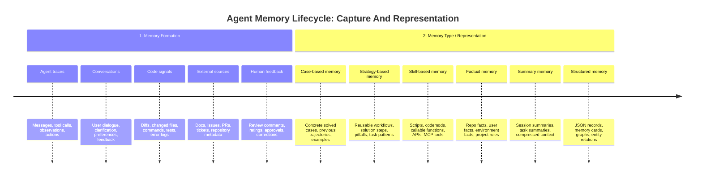
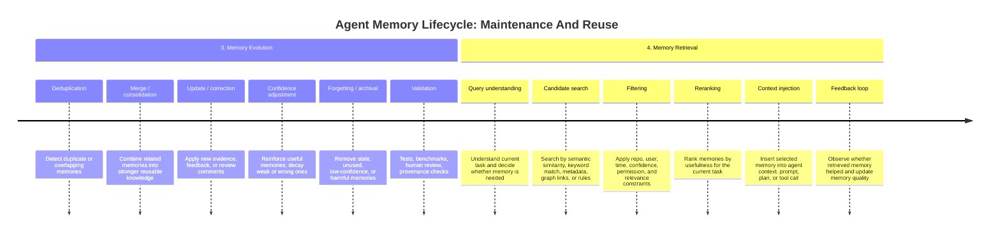

# Memory System Comparison

This document compares practical memory designs for AI coding agents.

The paper [*Memory in the Age of AI Agents*](https://arxiv.org/abs/2512.13564)
is useful background, but the goal here is to translate the main ideas into a
practical system-design discussion. This document answers a software
engineering design question:

> Compare this project with other cutting-edge / industry-level memory designs
> for AI agents. Explain the pros and cons, and discuss the evolution direction
> of this subject.

This comparison uses four engineering perspectives:

1. **Memory Formation**: how useful signals are captured and converted into
   memory.
2. **Memory Representation**: what kind of memory unit is stored.
3. **Memory Evolution**: how memory is updated, merged, corrected, or forgotten.
4. **Memory Retrieval**: how memory is found and injected back into agent
   context.

The focus is practical tradeoffs: what is easy to build, what is production
ready, what can go wrong, and how this project can evolve.

The examples below mix production products, open-source tools, and research
directions. They are grouped by design pattern rather than treated as identical
systems.

The lifecycle is split into two smaller diagrams so it remains readable in
GitHub's Mermaid renderer.

## Positioning Of This Project

This project focuses on reusable coding-agent experience.

Many existing systems focus on preserving current context, indexing repository
code, storing user preferences, or manually defining project instructions. This
project focuses on a different problem: how an agent can learn from completed
coding tasks.

The system saves completed agent traces, distills them asynchronously into
structured `TaskMemory` records, and retrieves them later through hybrid BM25
plus vector search, reranking, and progressive disclosure.

From a practical engineering perspective, this project is closest to
strategy-based experiential memory. It does not simply store raw trajectories,
and it does not yet generate executable skills. Instead, it extracts reusable
task patterns, solution steps, key files, and pitfalls from previous agent runs.

## Four Engineering Perspectives

### 1. Memory Formation: How Useful Signals Are Captured

Memory formation is about where the memory signal comes from.

Common industry patterns:

- Repository indexing and code search.
- Manual project instructions such as `CLAUDE.md`, `AGENTS.md`, and Copilot
  instructions.
- Conversation or user memory, such as ChatGPT memory and Mem0-style memory.
- Agent trace capture from tool calls, edits, test runs, and final outcomes.
- Skill or script authoring after repeated workflows.

Pros:

- Repository indexing gives the agent fresh information about the current
  codebase.
- Manual instructions are easy to review and control.
- Conversation memory improves personalization.
- Trace capture can learn from real task-solving experience.
- Skill authoring can turn repeated work into directly reusable tools.

Cons:

- Repository indexing does not remember what previous agents tried.
- Manual instructions depend on humans keeping them updated.
- Conversation memory can be too generic for engineering workflows.
- Trace capture needs filtering, otherwise noisy tasks become noisy memory.
- Skill generation is powerful but needs stronger validation and safety checks.

This project:

- Captures completed coding-agent traces.
- Saves raw traces first.
- Distills them asynchronously into reusable `TaskMemory` records.
- Focuses on coding task experience rather than generic conversation memory.

Evolution direction:

- Better trace filtering.
- Multi-turn session grouping.
- Higher-quality distillation.
- Human or benchmark-based validation before memory becomes trusted.

### 2. Memory Representation: What Is Stored

Memory representation describes what the system stores as reusable memory and
how that memory is structured.

Examples include raw chat history, repository facts, markdown instructions,
user preferences, task recipes, entity graphs, code snippets, or executable
skills.

Common industry patterns:

- Raw or summarized chat history.
- User preferences and personal facts.
- Repository facts with citations.
- Markdown project instructions.
- Entity/relationship graphs with temporal facts.
- Reusable skills, scripts, or tool instructions.
- Structured task recipes.

Pros:

- Raw history preserves detail.
- Markdown instructions are inspectable and easy to edit.
- Repository facts with citations are verifiable.
- Graph memory is strong for relationships and changing facts.
- Skills are directly reusable.
- Structured task recipes are compact and easier to rank/review.

Cons:

- Raw history is noisy and expensive to retrieve.
- Preferences are useful but often not enough for coding tasks.
- Facts do not capture full workflows.
- Graphs can add heavy infrastructure and maintenance cost.
- Skills are harder to generate safely.
- Task recipes depend on good distillation quality.

This project:

- Stores `TaskMemory` records.
- Each memory captures task pattern, description, key files, solution steps,
  pitfalls, confidence metadata, and provenance.
- The memory is designed to be inspected by humans and consumed by future
  coding agents.

Evolution direction:

- Add stronger provenance fields.
- Track `last_verified_commit` and `last_verified_at` for key files.
- Support richer memory types over time, such as executable scripts or
  generated MCP tools, after validation improves.

### 3. Memory Evolution: How Memory Is Maintained

Memory evolution is about quality control after memory is created.

Common industry patterns:

- User edits and deletes.
- Confidence scoring.
- Deduplication and merge.
- Citation or file validation.
- Temporal validity windows.
- Decay, pruning, archive, and forgetting.
- Feedback-driven correction.

Pros:

- User controls make memory safer and more understandable.
- Deduplication reduces noise.
- Merge helps repeated experiences strengthen one memory.
- Citation/file validation reduces stale advice.
- Forgetting prevents the store from growing forever.

Cons:

- Automatic updates can accidentally reinforce bad memory.
- Merge logic is difficult when two memories partially overlap.
- Staleness is hard in fast-changing codebases.
- Forgetting can remove useful rare knowledge if the policy is too aggressive.
- Quality control requires observability and evaluation, not just storage.

This project:

- Supports deduplication and merge after distillation.
- Supports factual/relevance ratings.
- Updates confidence based on feedback.
- Can trigger redistillation after incorrect-memory feedback.
- Has conservative forgetting/archive behavior.

Evolution direction:

- Add clearer trace ingestion policy.
- Add retrieval diagnostics and trace outcome dashboards.
- Improve stale-memory checks around files and commits.
- Use benchmark outcomes and human review to decide when memory is trusted.

### 4. Memory Retrieval: How Memory Is Reused

Memory retrieval is about finding the right memory at the right time and
injecting only the amount of context the agent needs.

Common industry patterns:

- Direct context loading.
- Repository RAG.
- BM25 keyword search.
- Vector semantic search.
- Hybrid retrieval and reranking.
- Graph traversal.
- Citation verification.
- Progressive disclosure.

Pros:

- BM25 is strong for exact names, files, and APIs.
- Vector search is strong for semantic similarity.
- Hybrid retrieval is more robust than either alone.
- Reranking improves precision.
- Progressive disclosure saves context by loading summaries before full memory.
- Verification prevents the agent from trusting stale code facts too quickly.

Cons:

- Retrieval can surface plausible but irrelevant memories.
- Vector search can miss exact technical terms.
- BM25 can miss paraphrased task similarity.
- Reranking adds latency and complexity.
- Progressive disclosure requires the agent to decide when to expand memory.

This project:

- Uses BM25 plus vector search.
- Combines candidates with RRF fusion.
- Reranks results.
- Supports cross-repo fallback.
- Uses L0/L1/L2 progressive disclosure so agents can inspect summaries before
  loading full memories.

Evolution direction:

- Add detailed retrieval diagnostics.
- Build held-out relevance datasets.
- Tune thresholds and reranker inputs.
- Add staleness-aware retrieval so old memories are lowered in trust or marked
  for verification.

## Design Pattern Comparison

The table below compares memory patterns rather than claiming that every
example has the same maturity level or exact feature set.

| Design Pattern | Example Systems | What They Store | Strengths | Limitations | Difference From This Project |
|---|---|---|---|---|---|
| **Repository indexing / RAG** | GitHub Copilot repo context, code search, local repository retrieval | Source files, docs, symbols, chunks | Strong for understanding the current codebase | Does not learn much from previous agent attempts | This project stores distilled experience from completed tasks |
| **Manual project instructions** | `CLAUDE.md`, `AGENTS.md`, Copilot instructions | Human-written rules, conventions, and project notes | Simple, controllable, easy to review | Manual maintenance; does not self-improve automatically | This project can create memory from traces automatically |
| **Conversation / user memory** | ChatGPT memory, Mem0-style memory | User facts, preferences, dialogue summaries | Good personalization and continuity | Less focused on coding workflows and tool-call exploration | This project is repo/task focused |
| **Agent fact memory with verification** | GitHub Copilot Memory | Repository facts, user preferences, code citations | Strong freshness model; directly code-aware | Mostly fact-level memory, not full workflow recipes | This project stores solution steps and pitfalls, not only facts |
| **Layered agent memory** | Research and platform systems with session, persona, task, and skill layers | Layered memories, scenarios, personas, sessions, skills, evidence refs | Good context organization and retrieval control | More complex; often broader than coding-task experience | This project keeps a narrower `TaskMemory` abstraction for coding workflows |
| **Graph / temporal memory** | Zep / Graphiti-style systems | Entities, relations, temporal facts, provenance | Good for relationship modeling and changing facts | More complex infrastructure and higher maintenance cost | This project currently uses simpler structured task memory with optional staleness metadata |
| **Skill memory** | Agent skills, generated tools, codemods, reusable procedures | Executable scripts, procedures, APIs, tool instructions | Directly reusable and powerful | Harder to generate safely; needs validation and rollback | This is a future direction for this project, not the current core |
| **SWE experience memory** | Issue-resolution memories and software-engineering experience cards | Structured experience cards from engineering tasks | Directly relevant to software engineering agents | Knowledge often comes from historical issues, not this agent's own repo runs | This project learns from completed agent traces in the target workflow |
| **This project** | Self-evolving coding-agent memory MCP | `TaskMemory` records from completed coding-agent traces | Learns from previous agent work; captures pitfalls; supports feedback and forgetting | Needs stronger evaluation, staleness checks, and production governance | Focused on trace-distilled coding task experience |

## Pros And Cons Of This Project Design

### Pros

- Learns from completed coding-agent tasks instead of only indexing the current
  repository.
- Stores structured memory, making it easier to inspect than raw conversation
  history.
- Captures both successful steps and pitfalls, which is useful for future agent
  runs.
- Uses hybrid retrieval, combining lexical and semantic search.
- Uses progressive disclosure, so the agent does not always need to load the
  full memory.
- Supports feedback through rating, confidence updates, redistillation, and
  forgetting.
- Fits naturally behind MCP tools, so multiple coding agents can use the same
  memory service.

### Cons / Current Limitations

- Memory quality depends on the quality of trace distillation.
- Bad or stale memories can degrade future agent behavior.
- Current memory is mostly strategy-like; it does not yet store executable
  skills or generated tools.
- Local JSON / Chroma / BM25 storage is good for a prototype, but production
  would need stronger durability, access control, audit logs, and observability.
- Evaluation is critical: benchmark regression tests are needed to prove that
  memory improves task success rather than adding noise.
- Trace ingestion needs stronger filtering so casual conversations or low-signal
  tasks do not become memory candidates.

## Evolution Direction And Use Cases

This project can evolve from a local proof of concept into a shared learning
layer for coding agents. The main use case is helping future agents reuse
experience from previous engineering work instead of rediscovering the same
steps from scratch.

At the field level, agent memory is also moving from passive context retrieval
toward actively managed systems. A useful memory system needs quality control,
provenance, feedback, staleness detection, and eventually safe skill generation.

### Near Term: Better Coding-Agent Assistance

- Reuse previous debugging, migration, and implementation experience.
- Help agents avoid repeated mistakes by retrieving known pitfalls.
- Reduce repeated exploration across similar tasks.
- Use benchmark fixtures to prove whether memory improves task success.
- Add better trace filtering so only useful coding tasks become memory
  candidates.
- Add multi-turn session grouping so one user task becomes one stronger memory
  candidate.

### Mid Term: Team-Level Engineering Memory

- Share task memories across repositories and teams.
- Capture recurring migration patterns, incident playbooks, release workflows,
  framework upgrade steps, and testing practices.
- Add access control, audit logs, redaction, and memory review workflows.
- Give teams an inspectable memory store instead of relying only on hidden
  model context.
- Add retrieval diagnostics so teams can understand why a memory was selected.
- Add staleness checks around files, commits, APIs, and architectural changes.

### Long Term: From Memory To Skills

- Convert repeated successful task patterns into executable scripts, codemods,
  MCP tools, or agent skills.
- Let agents decide when to read, write, update, or ignore memory.
- Add validation gates so generated skills are tested before reuse.
- Build organization-level memory that improves over time while preventing
  stale or incorrect knowledge from spreading.
- Support rollback and quality gates so self-evolving memory remains safe in
  production environments.

## Summary

This project is not just a repository RAG system and not just a chat memory
system.

It is a prototype of self-evolving memory for coding agents: completed task
traces are distilled into structured task memories, maintained through feedback
and forgetting, and retrieved later to improve similar future tasks.

The main engineering challenge is memory quality control. A useful memory
system must not only remember more, but remember the right things, retrieve them
at the right time, and prevent stale or incorrect memory from degrading future
results.
