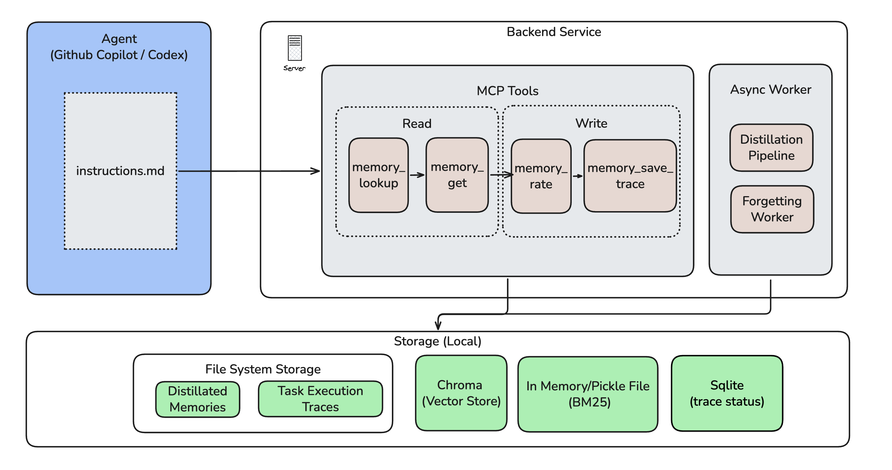
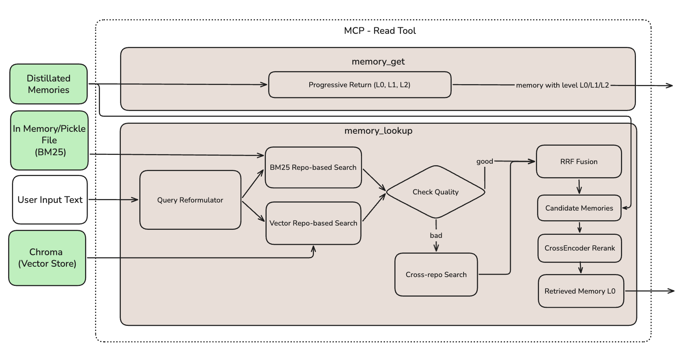
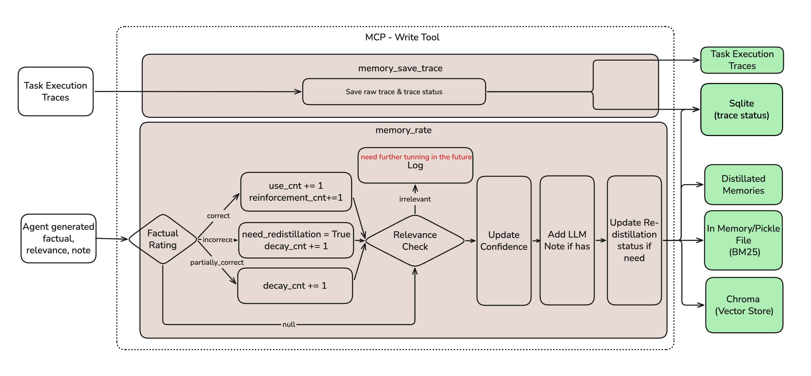
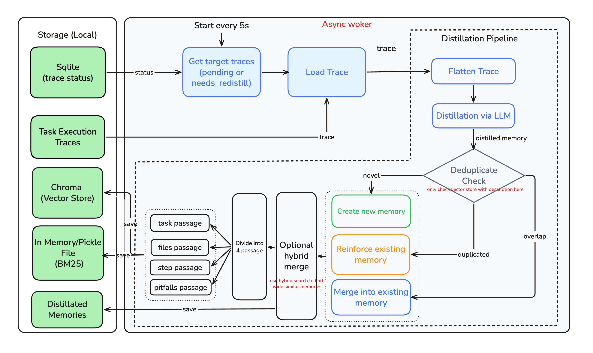

# Self-Evolving Agentic Memory

> An MCP memory server for coding agents.

An MCP-based memory server for coding agents. It stores compact `TaskMemory`
records distilled from previous agent runs, retrieves relevant memories for new
tasks, and lets agents rate, decay, correct, merge, or softly archive those
memories over time.

The core idea is simple: coding agents should not only solve the task in front
of them. They should also remember useful implementation patterns, reject stale
or incorrect advice, and improve their memory store as more tasks are completed.

---

## Demo


See the [fixture walkthroughs](fixtures/README.md) for reproducible scenarios.
The original externally hosted recording is not included in this distribution.


---

## Introduction

This project implements a self-evolving memory layer for AI coding agents using
MCP tools. A coding agent can:

1. Search for relevant prior task memories before editing code.
2. Expand a memory progressively from summary to detailed steps and pitfalls.
3. Apply, adapt, or reject the memory based on the current repository.
4. Rate memory quality after use.
5. Save the completed run as a new trace for background distillation.

The main implementation lives in [`src/agentic_memory`](src/agentic_memory).
The most important validation path is the benchmark fixture suite under
[`fixtures/`](fixtures/README.md).

---

## Architecture

For a source-level architecture walkthrough, see [`src/README.md`](src/README.md).

### System Overview



### MCP Read Path



### MCP Write Path



### Async Distillation Worker



```text
RUNTIME                                  OFFLINE / FEEDBACK
----------------------------------       ---------------------------------
Codex CLI / coding agent                 Completed task trace
   |                                           |
   v                                           v
memory_lookup()                          memory_save_trace()
   |                                           |
   v                                           v
Hybrid retrieval                          Trace flattening
(BM25 + vector + RRF + rerank)                 |
   |                                           v
   v                                     LLM distillation
Relevant TaskMemory                            |
   |                                           v
   v                                     Dedup / merge / upsert
Agent applies, rejects, or adapts               |
   |                                           v
   v                                     JSON + BM25 + Chroma store
memory_rate()
   |
   v
Forgetting worker softly archives
stale / low-value memories
```

Key modules:

| Module | Purpose |
|---|---|
| [`src/agentic_memory/schema.py`](src/agentic_memory/schema.py) | `TaskMemory`, `KeyFile`, and retrieval result dataclasses. |
| [`src/agentic_memory/store/`](src/agentic_memory/store) | JSON memory persistence, BM25 index, and Chroma vector store. |
| [`src/agentic_memory/retrieval/`](src/agentic_memory/retrieval) | Query reformulation, hybrid retrieval, RRF fusion, reranking, and progressive disclosure. |
| [`src/agentic_memory/distillation/`](src/agentic_memory/distillation) | Trace flattening, LLM extraction, deduplication, merging, and confidence reinforcement. |
| [`src/agentic_memory/forgetting/`](src/agentic_memory/forgetting) | Conservative background archival for stale, low-confidence, repeated-incorrect, or never-used memories. |
| [`src/agentic_memory/mcp_server/server.py`](src/agentic_memory/mcp_server/server.py) | FastMCP server exposing memory tools over stdio. |

---

## What This Repo Contains

| Path | Purpose |
|---|---|
| [`src/agentic_memory/`](src/agentic_memory) | Production MCP memory server package. |
| [`tests/`](tests) | Unit and integration tests for storage, retrieval, MCP tools, distillation, and forgetting. |
| [`fixtures/`](fixtures/README.md) | End-to-end benchmark tasks used to validate agent memory behavior. |
| [`examples/`](examples) | Local demos and simulated evaluation harnesses. |
| [`images/arch/`](images/arch) | Architecture diagrams used in this README. |

| [`.codex/config.toml`](.codex/config.toml) | Codex MCP server configuration for the local memory server. |
| [`.codex/agentic-memory.instructions.md`](.codex/agentic-memory.instructions.md) | Codex workflow instructions for fixture tasks. |
| [`.vscode/mcp.json`](.vscode/mcp.json) | VS Code GitHub Copilot MCP server configuration, kept for compatibility. |

---

## How To Try It With Codex CLI

Earlier demo runs used VS Code GitHub Copilot with MCP, but the recommended
path is now Codex CLI because it follows repository-level `AGENTS.md` and
`.codex/agentic-memory.instructions.md` workflows more consistently for this
project.

### 1. Install dependencies

```bash
cd /path/to/agentic-memory-mcp

uv sync --all-extras
```

Optional, but required for background LLM distillation:

```bash
cp .env.example .env
# set OPENAI_API_KEY in .env or your shell
```

### 2. Prepare the environment

Before starting Codex, export `OPENAI_API_KEY` in the same terminal session so
Codex and the MCP server can inherit it:

```bash
export OPENAI_API_KEY="..."

# Seed neutral E2E runtime data from the repository root
uv run python fixtures/seed_e2e_data.py --reset

codex
```

Codex reads [`AGENTS.md`](AGENTS.md), which scopes the memory workflow to code
and fixture tasks under `fixtures/`. The local MCP server is configured in
[`.codex/config.toml`](.codex/config.toml).

### 3. Run a fixture task

Use the skill-based fixture runner flow. For the full case matrix and expected
outcomes, see [`fixtures/README.md`](fixtures/README.md).

In agent chat, run the fixture skill command with your target case. For example:

```text
› $agentic-memory-fixture-runner I wanna test incident-case
```

This command should kick off the incident-case fixture flow and run the related
validation steps automatically.

### GitHub Copilot Compatibility

The Codex CLI path above is the recommended benchmark path. For older VS Code
GitHub Copilot Agent runs, [`.vscode/mcp.json`](.vscode/mcp.json) can still
start the same MCP server, and [`.github/copilot-instructions.md`](.github/copilot-instructions.md)
points Copilot at the fixture-scoped memory workflow. Launch VS Code from a
shell where `OPENAI_API_KEY` is already exported so the MCP server inherits it.

---

## Test Coverage

Run the implementation-level test suite:

```bash
uv run pytest tests/ -v
```

Current unit and integration coverage includes:

| Area | Covered behavior |
|---|---|
| Schema | Serialization and validation for memory records and retrieval results. |
| Storage | JSON persistence, BM25 indexing, Chroma vector indexing, and trace status storage. |
| Retrieval | Hybrid BM25/vector retrieval, RRF fusion, reranking, query reformulation, and progressive disclosure. |
| Distillation | Trace flattening, LLM extraction boundaries, deduplication, merging, and confidence updates. |
| MCP tools | Tool-level behavior for lookup, get, rate, save trace, trace status, CRUD, and worker status. |
| Forgetting | Soft archival for stale, low-value, repeated-incorrect, or unused memories. |
| Redistillation | Incorrect-memory feedback can queue a trace for re-distillation when supporting trace data exists. |

---

## Benchmark / E2E Evidence

See [`fixtures/README.md`](fixtures/README.md) for the benchmark matrix,
verified-flow links, expected-memory files, and run evidence.

| Scenario | What it demonstrates |
|---|---|
| Synthetic workflow case | An arbitrary workflow name is learned from one fixture and recalled in another where the prompt does not define it. |
| Migration case | Long autonomous Nuxt migration and cross-repo memory reuse. |
| Stale-memory case | Agent validates memory against the current repo and rejects stale or incorrect guidance. |
| Incident case | Day-2 debugging workflow using logs, webhook behavior, and prior production context. |
| Memory-merge case | Related traces accumulate into a stronger merged memory instead of creating noisy duplicates. |
| Implementation tests | `uv run pytest tests/ -v` verifies the underlying memory server behavior. |

The fixture flows are the main project evidence. They show an agent retrieving
prior work, checking it against the current repo, applying or rejecting it,
rating the result, and saving a new trace that can become future memory.

---

## MCP Tools

| Tool | Purpose |
|---|---|
| `memory_lookup(task, repo_id, top_k)` | Retrieve relevant L0 memory summaries for a task. |
| `memory_get(memory_id, level)` | Expand a memory at L0, L1, or L2 detail. |
| `memory_rate(memory_id, factual, relevance, note)` | Reinforce, decay, or flag memory after use. |
| `memory_save_trace(repo_id, task, messages, trace_id)` | Persist a completed run and enqueue it for background distillation. |
| `memory_trace_status(trace_id)` | Check a saved trace's distillation outcome: created, merged, duplicate, or failed. |
| `memory_add(...)` | Directly add a memory. |
| `memory_update(...)` | Patch an existing memory. |
| `memory_delete(memory_id)` | Remove stale or harmful memory. |
| `memory_worker_status()` | Report distillation queue state and forgetting-worker health. |

---

## Examples

For example-only demos, scripts, outputs, and usage instructions, see
[examples/README.md](examples/README.md).

---

## Known Limitations

- SQLite/Chroma file permissions can cause read-only database errors if the MCP
  server is restarted under a different process context.
- Merge thresholds are heuristic and may need tuning per corpus.
- LLM distillation requires `OPENAI_API_KEY`; retrieval and most implementation
  tests can run without it.

---

## Roadmap

See [ROADMAP.md](ROADMAP.md) for the consolidated Phase II and Phase III plan.
