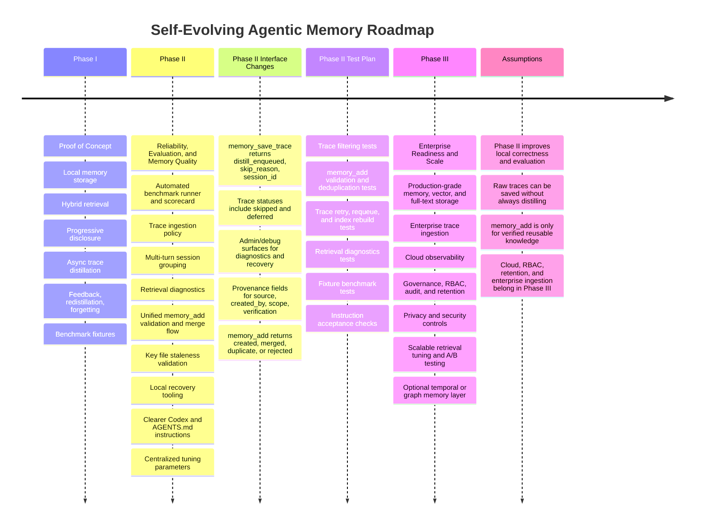

# Roadmap

This roadmap is the single source of truth for post-Phase I work on the
self-evolving agentic memory project.

Phase I is the current proof of concept: local memory storage, hybrid
retrieval, progressive disclosure, asynchronous trace distillation, feedback,
redistillation, forgetting, and benchmark fixtures are implemented.

## Visual Roadmap

## Phase II: Reliability, Evaluation, And Memory Quality

Phase II strengthens the current local/demo system without requiring production
cloud infrastructure. The goal is to make memory quality measurable, reduce
noisy memories, improve retrieval debuggability, and make agent behavior more
consistent.

- Add an automated benchmark runner and scorecard for the existing fixture
  matrix: cold run vs memory-assisted run, task success, retrieved memory
  relevance, factual rating, tool-call count, trace outcome, and
  merge/duplicate behavior.
- Add trace ingestion policy before distillation: always save raw traces for
  audit/debugging, but enqueue distillation only when the task is
  code/project-related and has enough reusable signal. Skip unrelated tasks
  such as weather, greetings, or pure conversation.
- Add multi-turn session grouping so traces from the same user task/session are
  distilled as one candidate instead of one candidate per chat turn.
- Add retrieval diagnostics in debug/admin output: BM25 score, vector score,
  RRF rank, rerank score, cross-repo flag, confidence filter reason, and final
  rank.
- Improve `memory_add` so agent-initiated online memory creation goes through
  the same validation, deduplication, and merge rules as offline distillation.
- Add staleness validation around `key_files`: check whether key files still
  exist, update `last_verified_at` / `last_verified_commit`, and annotate or
  lower trust for stale paths before use.
- Add local recovery tooling: retry failed traces, requeue stuck traces,
  repair/rebuild BM25 and vector indexes from stored memory JSON, and surface
  queue health.
- Tighten `.codex/agentic-memory.instructions.md` and `AGENTS.md` guidance:
  when to look up memory, when to fetch L1/L2, when to rate, when to save
  traces, when not to distill, and when `memory_add` is appropriate.
- Centralize and document tuning parameters: retrieval thresholds, confidence
  deltas, merge thresholds, trace filter rules, forgetting thresholds, reranker
  candidate text, and cross-repo fallback thresholds.

### Phase II Interface Changes

- Extend `memory_save_trace` response with `distill_enqueued`, `skip_reason`,
  and `session_id`.
- Add trace status values `skipped` and `deferred`, while keeping existing
  values: `pending`, `processing`, `processed`, `failed`, and
  `needs_redistill`.
- Add admin/debug surfaces for retrieval diagnostics and trace recovery.
- Add memory provenance fields for `source`, `created_by`, `scope`,
  `last_verified_commit`, and `last_verified_at`.
- Update `memory_add` to return the same outcome language as distillation:
  `created`, `merged`, `duplicate`, or `rejected`.

### Phase II Test Plan

- Unit tests for trace filtering: code task accepted, weather/chat skipped,
  low-signal trace skipped, and multi-turn session merged.
- Unit tests for `memory_add` validation, deduplication, and merge behavior.
- Integration tests for failed trace retry, orphan requeue, and index rebuild.
- Retrieval tests that assert diagnostics include BM25/vector/RRF/rerank data.
- Benchmark runner tests against the existing fixture cases: migration,
  stale/incorrect memory, incident, and memory merge.
- Instruction acceptance checks against fixture logs: agent must look up first,
  use L1 before L2, rate retrieved memories correctly, and save only useful
  final traces.

## Phase III: Enterprise Readiness And Scale

Phase III moves the design from a local proof of concept toward production use
across teams, repositories, and enterprise agent infrastructure.

- Move from local JSON/SQLite/Chroma/BM25 persistence to production-grade
  storage: durable memory DB, managed vector search, full-text index,
  migrations, backups, and point-in-time recovery.
- Add an enterprise trace ingestion adapter that consumes an AI gateway
  traces, groups sessions, redacts sensitive data, and feeds accepted traces
  into the same distillation pipeline.
- Add cloud observability through structured JSON logs suitable for GCP or
  other observability systems: lookup quality, wrong matches, ratings,
  distillation outcomes, merge decisions, queue health, and worker failures.
- Add governance: RBAC for `memory_add`, `memory_update`, and `memory_delete`;
  team/repo/org memory scopes; audit trails; retention policy; and human review
  workflow.
- Add privacy and security controls: secret and PII redaction before
  persistence/distillation, configurable retention windows, and compliance-safe
  trace sampling.
- Add scalable retrieval tuning: richer reranker candidate text, held-out
  relevance dataset, A/B testing for query reformulation, and eventual
  fine-tuned embedding/reranker models.
- Add an optional temporal or graph memory layer for high-churn repositories:
  track file/path validity over commits and surface stale memory automatically.

## Assumptions

- Phase II should improve correctness and evaluation within the current local
  implementation.
- Raw traces may still be saved for audit/debugging, but not every saved trace
  should trigger distillation.
- `memory_add` should remain available, but only for verified reusable
  knowledge and never for casual observations or hidden reasoning.
- GCP/cloud logging, production database recovery, RBAC, retention, and
  enterprise-scale ingestion belong in Phase III.
