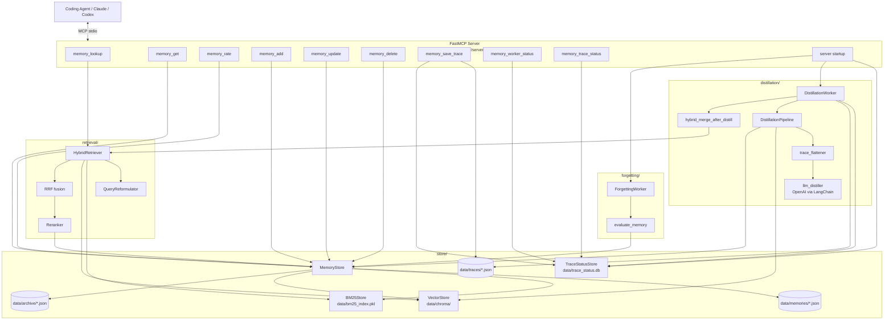
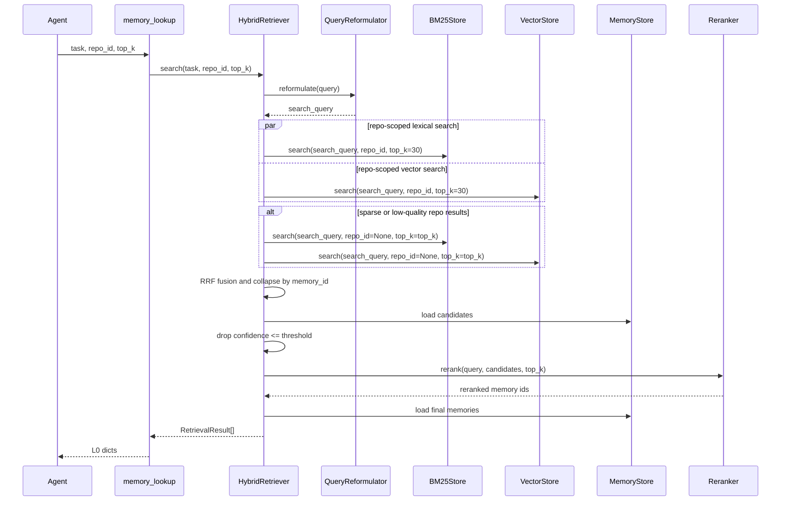
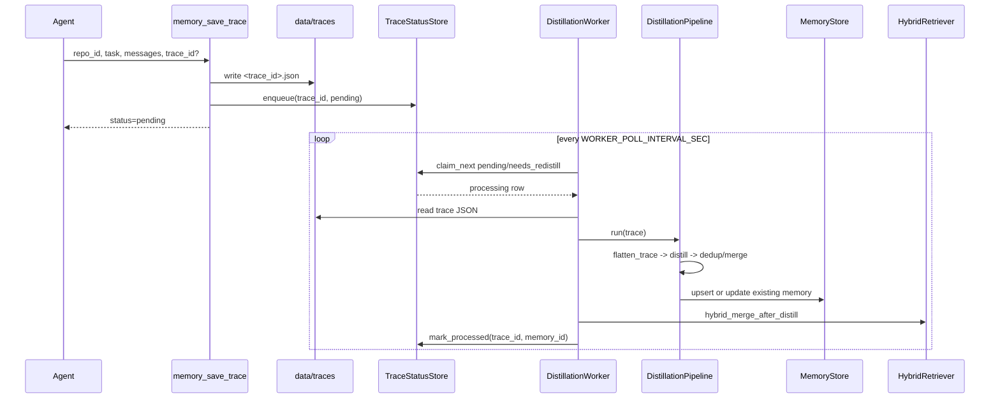
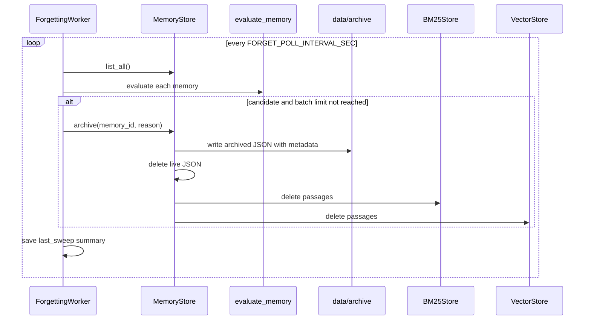
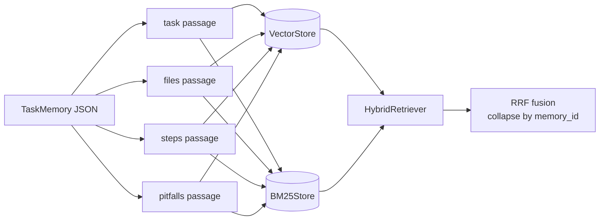

# Agentic Memory — Architecture Overview

A FastMCP server that captures agent task traces, stores reusable `TaskMemory`
records, and retrieves them with progressive disclosure through hybrid
BM25 + vector search.

The current implementation separates the public MCP tools from storage,
retrieval, distillation, and background trace processing:

```text
src/agentic_memory/
  mcp_server/      FastMCP tool surface and worker startup
  store/           JSON memory store, Chroma vector store, BM25 index,
                   SQLite trace status queue
  retrieval/       query reformulation, hybrid retrieval, reranking,
                   progressive disclosure formatting
  distillation/    trace flattening, LLM extraction, dedup/merge pipeline,
                   background worker
  forgetting/      conservative memory archival worker
  schema.py        TaskMemory, KeyFile, RetrievalResult dataclasses
  setting.py       environment-driven configuration
```

---

## 1. High-Level Architecture



---

## 2. MCP Tools

All tools are decorated with `@mcp.tool()` in
[agentic_memory/mcp_server/server.py](agentic_memory/mcp_server/server.py).

### `memory_lookup(task, repo_id, top_k=5)`

Searches for relevant memories and returns L0 summaries only.

- Delegates to `HybridRetriever.search()`.
- Searches the requested repo first.
- Falls back to cross-repo search when repo results are sparse or low quality.
- Returns `id`, `task_pattern`, `description`, `confidence`, and retrieval
  `score`.

Call `memory_get(id, level="L1")` to triage (key files and step/pitfall counts).
Call `memory_get(id, level="L2")` only when L1 is relevant or ambiguous enough
that actual steps and pitfalls may matter. If L1 is clearly irrelevant, skip L2.
L1 returns counts only — not the step content.

### `memory_get(memory_id, level="L1")`

Loads one memory from `MemoryStore` and formats it with progressive disclosure:

| Level | Contents |
|---|---|
| `L0` | id, task pattern, description, confidence, score |
| `L1` | L0 + key file paths + step/pitfall counts |
| `L2` | full memory, including steps, pitfalls, anchors, notes, counts, and provenance |

The formatter lives in
[agentic_memory/retrieval/progressive.py](agentic_memory/retrieval/progressive.py).

### `memory_rate(memory_id, factual?, relevance?, note?)`

Updates quality signals after a retrieved memory is assessed.

- `factual="correct"` increases confidence, `use_count`, and
  `reinforcement_count`, and records `last_used_at`.
- `factual="partially_correct"` decreases confidence and increases
  `decay_count`.
- `factual="incorrect"` decreases confidence, increases `decay_count`, and, if
  the memory has a `source_trace_id`, marks that source trace as
  `needs_redistill` in `TraceStatusStore`.
- `relevance="irrelevant"` is logged for future retrieval tuning. When a memory
  is irrelevant, leave `factual` unset/null so factual confidence is not changed.
- `note` is appended to `memory.notes`, capped by `MAX_MEMORY_NOTES`.

Re-distillation is asynchronous: `memory_rate` only queues the source trace for
the background worker.

### `memory_add(repo_id, task_pattern, description, key_files, solution_steps, pitfalls, outcome="success")`

Writes a memory directly without LLM distillation. It constructs a `TaskMemory`
with `source_trace_id="agent-initiated"` and calls `MemoryStore.upsert()`.

### `memory_update(memory_id, description?, key_files?, solution_steps?, pitfalls?, outcome?)`

Partially replaces selected fields on an existing memory, bumps `updated_at`, and
re-indexes the memory through `MemoryStore.upsert()`.

### `memory_delete(memory_id)`

Deletes the canonical JSON file and removes the memory from both retrieval
indexes.

### `memory_save_trace(repo_id, task, messages, trace_id?)`

Persists a completed run as a raw trace and enqueues it for background
distillation.

Current behavior:

1. Generates a trace id when one is not provided.
2. Writes `data/traces/<trace_id>.json`.
3. Inserts a `pending` row into `TraceStatusStore`.
4. Returns immediately with `{"ok": true, "trace_id": ..., "status": "pending"}`.

It does not run the LLM inline anymore. Distillation is handled by
`DistillationWorker`.

### `memory_trace_status(trace_id)`

Returns the distillation status of a saved trace so an agent can confirm what the
background worker did after `memory_save_trace`. Reads the row from
`TraceStatusStore` and returns:

- `status` — `pending` | `processing` | `processed` | `failed` | `needs_redistill`
- `distill_action` — `created` | `merged` | `duplicate` | `failed` | `unknown`
- `memory_id` — resulting memory id, or `null` for duplicate/failed
- `attempts`, `last_error`, `updated_at`

Returns `null` if the `trace_id` is unknown. The worker polls every few seconds,
so immediately after `memory_save_trace` the status is normally `pending` /
`processing` with `distill_action="unknown"`; that is the expected interim state.

### `memory_worker_status()`

Reports worker and queue health:

- `worker_enabled`
- `worker_running`
- `pipeline_available` (`OPENAI_API_KEY` presence)
- `queue` counts grouped by status
- `forgetting_enabled`
- `forgetting_running`
- `forgetting_last_sweep`

---

## 3. Read Pipeline



Important retrieval settings live in
[agentic_memory/setting.py](agentic_memory/setting.py):

- `RETRIEVAL_CANDIDATE_TOP_K` controls candidate count per store.
- `RRF_K` and `RRF_OUTPUT_LIMIT` control fusion.
- `CONFIDENCE_THRESHOLD` filters low-trust memories.
- `CROSS_REPO_SCORE_THRESHOLD` helps decide cross-repo fallback.

---

## 4. Trace Write and Worker Pipeline

`memory_save_trace` is intentionally cheap. It captures the run and leaves LLM
work to the background thread started from `server.py`.



If there is no `OPENAI_API_KEY`, the pipeline factory returns `None`. The worker
marks the claimed trace as `failed` with a pipeline-unavailable message; the raw
trace remains on disk.

On server startup:

1. `_backfill_existing_traces()` marks old trace files missing from the status
   DB as `processed` so historical traces are not unexpectedly re-distilled.
2. `_start_worker()` starts `DistillationWorker` when `WORKER_ENABLED=true`.
3. `_start_forgetting_worker()` starts `ForgettingWorker` when
   `FORGET_ENABLED=true`.
4. The distillation worker requeues orphaned `processing` rows, which covers crashes during
   distillation.

---

## 5. Distillation and Merge Behavior

`DistillationPipeline` in
[agentic_memory/distillation/pipeline.py](agentic_memory/distillation/pipeline.py)
orchestrates:

1. `flatten_trace(trace)` turns the trace dict into LLM-ready text.
2. `distill(flattened, llm)` extracts a structured memory dict.
3. `_dict_to_memory()` converts the extracted dict to `TaskMemory`.
4. `_dedup_check()` searches existing task passages in the vector store.
5. The pipeline reinforces, merges, or writes the memory.

Deduplication thresholds:

| Score | Action |
|---:|---|
| `>= DUPLICATE_THRESHOLD` | Treat as duplicate; increase existing confidence and reinforcement count. |
| `>= OVERLAP_THRESHOLD` with same `task_pattern` | Merge into existing memory. |
| `>= CROSS_PATTERN_MERGE_THRESHOLD` with different `task_pattern` | Allow high-similarity cross-pattern merge. |
| below thresholds | Insert as novel memory. |

After pipeline deduplication, `DistillationWorker` runs a second-pass
`hybrid_merge_after_distill()` from
[agentic_memory/distillation/worker.py](agentic_memory/distillation/worker.py).
This catches conceptual duplicates that lexical + vector retrieval ranks
strongly even when pure task-passage similarity is not enough. It merges
pitfalls, lexical anchors, key files, and the more detailed solution steps, then
deletes the newly inserted duplicate.

---

## 6. Forgetting and Archival

`ForgettingWorker` in
[agentic_memory/forgetting/worker.py](agentic_memory/forgetting/worker.py)
periodically scans live memories and soft-archives low-value entries. It mirrors
the distillation worker lifecycle: daemon thread, `start()`, `stop()`, poll loop,
and a remembered `last_sweep` summary.

Forgetting is intentionally conservative:

- Memories younger than `FORGET_MIN_AGE_DAYS` are protected.
- Memories with `use_count >= FORGET_PROTECT_USE_COUNT` and confidence above
  `FORGET_CONFIDENCE_FLOOR` are protected.
- A single incorrect rating does not archive a memory by itself.
- Candidates are moved to `data/archive/`, stamped with `archived_at` and
  `forget_reason`, removed from `data/memories/`, and de-indexed from BM25 and
  Chroma.
- Nothing is hard-deleted by the forgetting worker.

`evaluate_memory(memory, now)` returns the first matching reason:

| Reason | Rule |
|---|---|
| `repeated_incorrect` | confidence at/below `FORGET_CONFIDENCE_FLOOR` and `decay_count >= FORGET_DECAY_COUNT_THRESHOLD` |
| `low_confidence` | confidence at/below `FORGET_CONFIDENCE_FLOOR` |
| `stale` | last activity is at least `FORGET_STALENESS_DAYS` old |
| `never_used` | `use_count == 0` and age is at least `FORGET_UNUSED_AGE_DAYS` |

Last activity is `last_used_at` when present, otherwise `updated_at`.
`last_used_at` is set when a memory is rated `factual="correct"`.



---

## 7. Storage Layer

`MemoryStore` in
[agentic_memory/store/memory_store.py](agentic_memory/store/memory_store.py)
is the unified read/write API over canonical memory JSON plus both indexes.

On every `upsert(memory)` it:

1. Writes canonical JSON to `data/memories/<memory_id>.json`.
2. Builds index passages with `_build_passages(memory)`.
3. Upserts those passages into `VectorStore`.
4. Upserts those passages into `BM25Store`.

On `delete(memory_id)` it removes the JSON file and both index entries.

On `archive(memory_id, reason)` it writes a recoverable copy to
`data/archive/<memory_id>.json` with `archived_at` and `forget_reason`, then
removes the memory from the live store and indexes.

`TraceStatusStore` in
[agentic_memory/store/trace_status_store.py](agentic_memory/store/trace_status_store.py)
tracks raw trace processing in SQLite. Status values are:

- `pending`
- `processing`
- `processed`
- `needs_redistill`
- `failed`

It provides atomic claiming via SQLite `UPDATE ... RETURNING`, WAL mode for
worker/server use, and orphan requeueing for interrupted processing.

---

## 8. The Four Index Passages

A `TaskMemory` is not indexed as one large blob. `MemoryStore._build_passages`
splits it into up to four separately indexed passages, each tagged with the
same `memory_id` and `repo_id`.

| Passage | Source fields | Prefix format | What it helps answer |
|---|---|---|---|
| `task` | `task_pattern` + `description` | `{repo_id} \| pattern. description` | High-level intent queries. Always present. |
| `files` | `key_files[].path` | `{repo_id} \| path1 path2 ...` | Queries mentioning files, classes, routes, or components. |
| `steps` | `solution_steps[]` | `{repo_id} \| step1 step2 ...` | Procedural/how-to queries. |
| `pitfalls` | `pitfalls[]` | `{repo_id} \| warning1 warning2 ...` | Error, symptom, and gotcha queries. |



This multi-passage design improves recall because a query can match different
facets of the same memory. RRF collapses passage hits by `memory_id`, so a
memory that matches on both intent and symptoms ranks above a memory that only
matched one passage.

Deduplication uses only the task-style text (`repo_id | task_pattern.
description`) so similar problem statements merge even when their file lists or
steps differ.

---

## 9. Configuration

Most tunables are centralized in
[agentic_memory/setting.py](agentic_memory/setting.py). `OPENAI_API_KEY`
is read directly by `mcp_server/server.py` when it builds the lazy
distillation pipeline.

| Area | Variables |
|---|---|
| Storage | `MEMORY_DATA_DIR`, `CHROMA_PERSIST_DIR`, `TRACE_DIR`, `TRACE_STATUS_DB_PATH`, `CHROMA_COLLECTION_NAME`, `CHROMA_SPACE` |
| Retrieval | `DEFAULT_LOOKUP_TOP_K`, `DEFAULT_RETRIEVER_TOP_K`, `RETRIEVAL_CANDIDATE_TOP_K`, `RRF_K`, `RRF_OUTPUT_LIMIT`, `CONFIDENCE_THRESHOLD`, `CROSS_REPO_SCORE_THRESHOLD`, `QUERY_SENTENCE_MIN_WORDS` |
| Models | `EMBEDDING_MODEL`, `RERANKER_MODEL`, `DISTILL_MODEL`, `DISTILL_TEMPERATURE`, `OPENAI_API_KEY` |
| Distillation/merge | `DUPLICATE_THRESHOLD`, `OVERLAP_THRESHOLD`, `CROSS_PATTERN_MERGE_THRESHOLD`, `MERGE_THRESHOLD`, `HYBRID_MERGE_TOP_K` |
| Quality | `DEFAULT_MEMORY_CONFIDENCE`, `CORRECT_CONFIDENCE_DELTA`, `INCORRECT_CONFIDENCE_DELTA`, `PARTIAL_CONFIDENCE_DELTA`, `DUPLICATE_CONFIDENCE_DELTA`, `MAX_MEMORY_NOTES` |
| Trace/worker | `TRACE_RESULT_MAX_CHARS`, `WORKER_POLL_INTERVAL_SEC`, `WORKER_MAX_ATTEMPTS`, `WORKER_ENABLED` |
| Forgetting | `FORGET_ENABLED`, `FORGET_POLL_INTERVAL_SEC`, `FORGET_CONFIDENCE_FLOOR`, `FORGET_STALENESS_DAYS`, `FORGET_DECAY_COUNT_THRESHOLD`, `FORGET_UNUSED_AGE_DAYS`, `FORGET_MIN_AGE_DAYS`, `FORGET_PROTECT_USE_COUNT`, `FORGET_BATCH_LIMIT` |

`MemoryStore` creates its vector index under `MEMORY_DATA_DIR/chroma` by default.
`CHROMA_PERSIST_DIR` is used when `VectorStore` is constructed without an
explicit path.

`MemoryStore` archives under `MEMORY_DATA_DIR/archive` for its default server
path.

---

## 10. Module Responsibilities

| Module | Responsibility |
|---|---|
| `schema.py` | Dataclasses for memories, key files, retrieval results, usage recency, and archival metadata. |
| `mcp_server/server.py` | FastMCP tools, global store/retriever/status instances, trace persistence, distillation/forgetting worker startup, worker status reporting. |
| `store/memory_store.py` | Canonical memory JSON persistence and coordinated index writes/deletes/archive moves. |
| `store/vector_store.py` | Chroma-backed semantic passage index. |
| `store/bm25_store.py` | Pickled BM25 lexical passage index. |
| `store/trace_status_store.py` | SQLite queue/status tracking for trace distillation. |
| `retrieval/hybrid_retriever.py` | Repo-scoped and cross-repo search, RRF fusion, confidence filtering, reranking. |
| `retrieval/query_reformulator.py` | Lightweight query cleanup/reformulation before search. |
| `retrieval/reranker.py` | Cross-encoder reranking with fallback behavior. |
| `retrieval/progressive.py` | L0/L1/L2 memory formatting. |
| `distillation/trace_flattener.py` | Converts trace JSON into compact LLM input. |
| `distillation/llm_distiller.py` | Prompt and JSON extraction for memory distillation. |
| `distillation/pipeline.py` | LLM distillation, vector deduplication, merge/upsert decisions. |
| `distillation/worker.py` | Background polling, retry handling, redistillation notes, second-pass hybrid merge. |
| `forgetting/worker.py` | Background archival sweeps for stale, low-confidence, repeated-incorrect, or never-used memories. |
